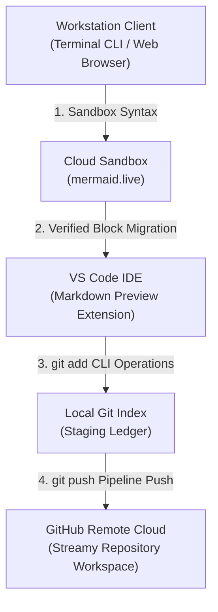
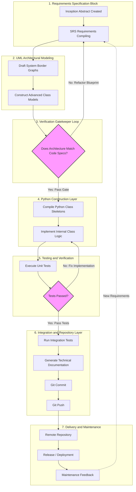
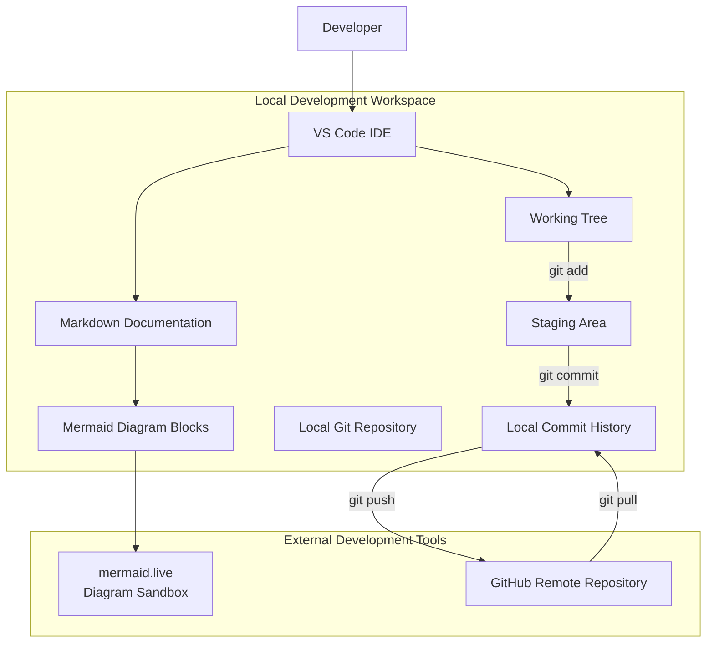
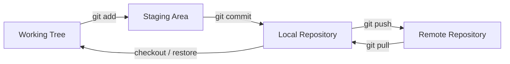
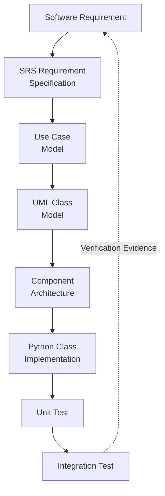
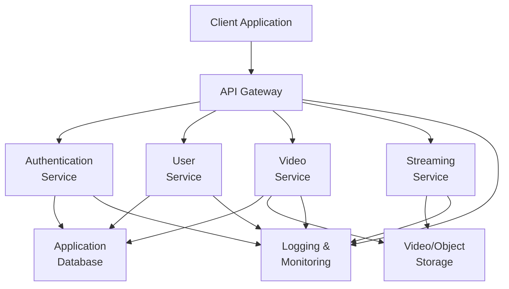
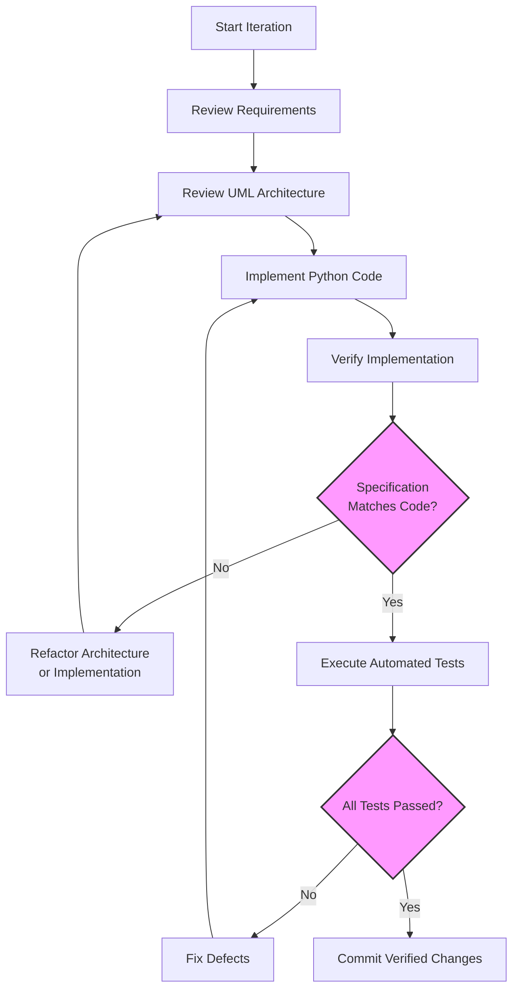
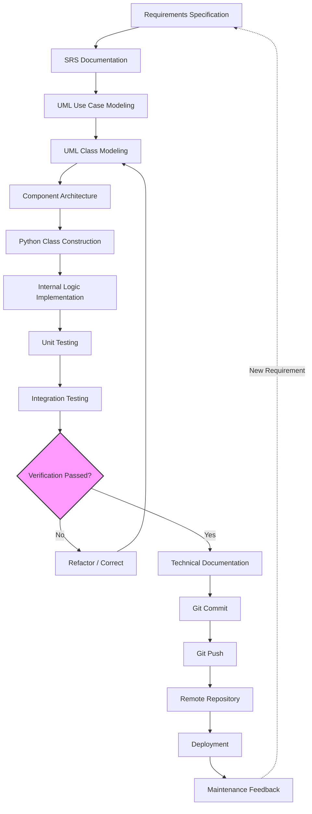
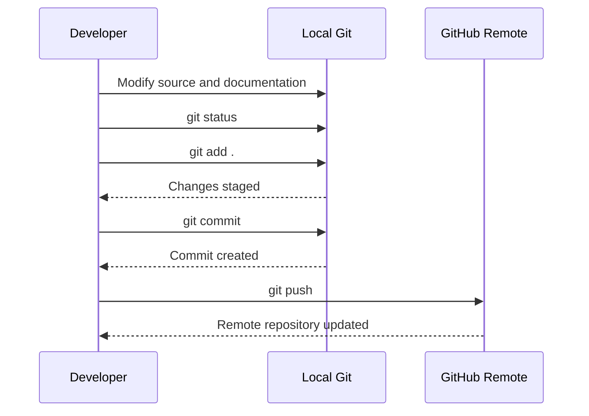

# Streamy Video Streaming Backend Platform

## Software Technology Course Laboratory Node

* **Student Identity:** [Libihong]
* **Neptun System Code:** [L3UC28]
* **Course Section Reference:** GETAL314-B2a

---

## Workspace Environment Architecture

The diagram below maps out how our development environment connects local code authoring to remote version tracking, using a **Diagrams-as-Code** design pipeline.



---

# Streamy Iterative SDLC Blueprint

The following diagram describes the iterative software development lifecycle used for the Streamy backend platform.



---

## System Development Flow

This diagram shows the main progression from requirements to implementation and deployment.

```mermaid
flowchart LR

    Requirements["Requirements<br>Specification"]
    Architecture["UML<br>Architecture"]
    Design["Detailed<br>System Design"]
    Implementation["Python<br>Implementation"]
    Testing["Unit &<br>Integration Testing"]
    Documentation["Technical<br>Documentation"]
    Repository["Git<br>Repository"]
    Deployment["Deployment"]

    Requirements --> Architecture
    Architecture --> Design
    Design --> Implementation
    Implementation --> Testing
    Testing --> Documentation
    Documentation --> Repository
    Repository --> Deployment

    Testing -.->|Defects| Implementation
    Architecture -.->|Architecture Review| Requirements
    Deployment -.->|Maintenance Feedback| Requirements
```



---

## Workspace Development Environment

The development workspace connects the developer, VS Code, Markdown documentation, Mermaid diagrams, Git, and the remote GitHub repository.



---

## Git Version Control Pipeline

The following diagram represents the local Git workflow used to synchronize implementation work with the remote repository.



---

## Requirements to Implementation Traceability

This diagram connects the software requirements with architectural design, implementation, and verification activities.



---

## Streamy Backend Architecture

The following architecture describes the main logical components of the Streamy video streaming backend.



---

## Iterative Verification Loop

The development process uses verification gates to ensure that the implementation remains consistent with the architecture and requirements.



---

## Complete Streamy Development Lifecycle

The complete process combines specification, modeling, implementation, testing, version control, and deployment.



---

## Development Commands

The following commands represent the basic local Git workflow.

```bash
git status

git add .

git status

git commit -m "Update Streamy backend architecture and documentation"

git push
```

---

## Repository Synchronization



---

## Summary

The Streamy development environment follows a **Diagrams-as-Code** workflow in which:

1. Requirements are documented using Markdown.
2. Architecture is represented using Mermaid diagrams.
3. The development environment is managed through VS Code.
4. Python implementation follows the defined architecture.
5. Unit and integration testing provide verification.
6. Git provides local version control.
7. GitHub provides remote repository synchronization.
8. Verification feedback can return the development process to requirements or architectural design.
9. The iterative lifecycle supports continuous refinement of the Streamy backend platform.
