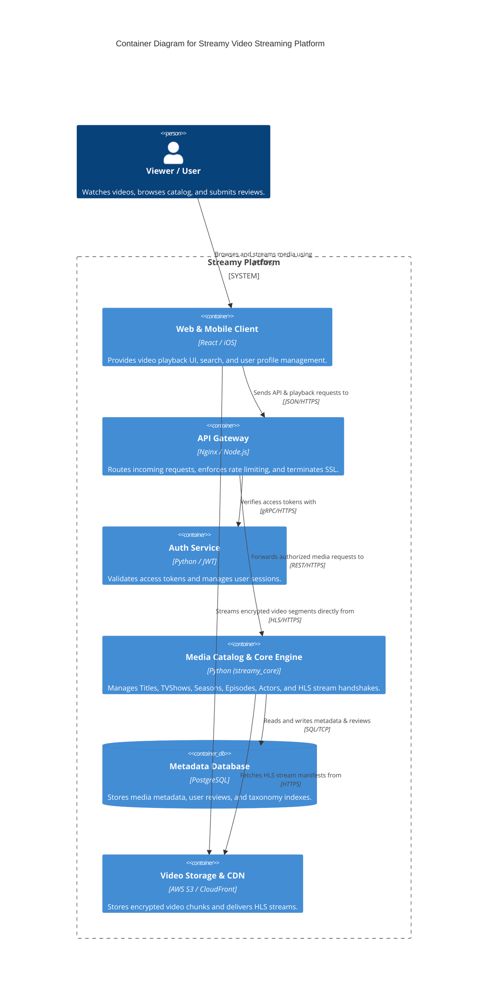

# Streamy System Architecture (C4 Container Diagram)

This document illustrates the high-level container architecture for the Streamy Video Streaming Platform, generated automatically via GitHub Actions.

## Container View

