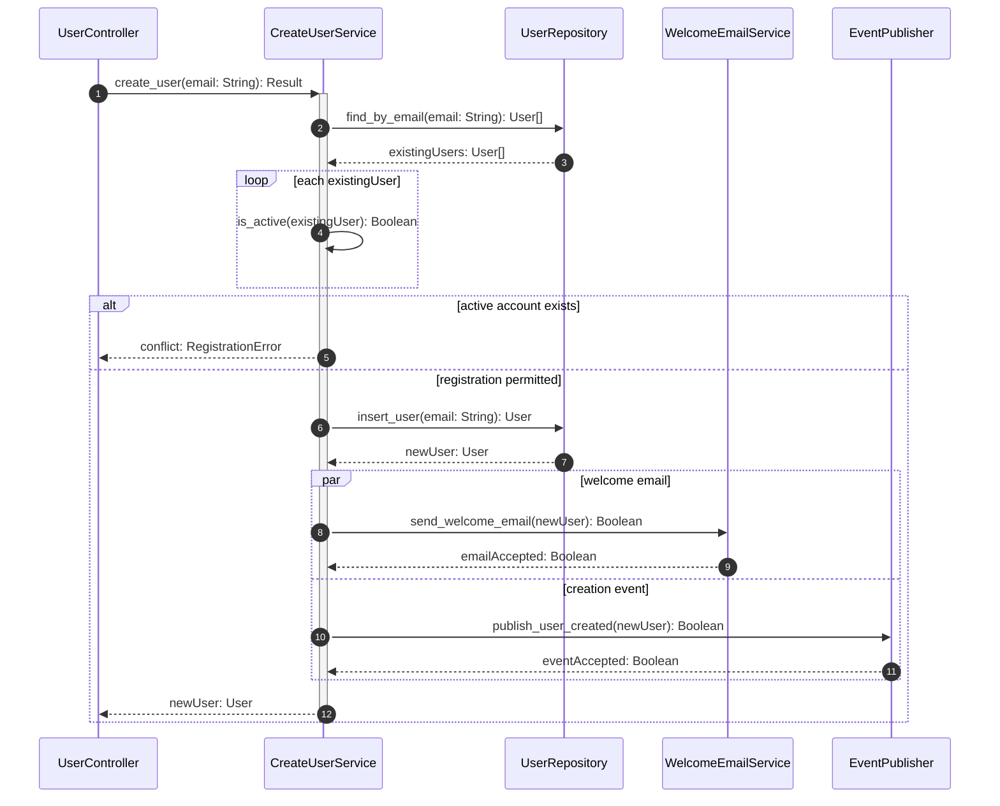

# Streamy POST /users Registration Sequence Flow

## 1. Sequence Diagram

### Architectural Analysis & Code Smells

1. **Leaky Abstractions**: Iterating over all matched users in the application layer to identify active accounts can be inefficient and leaks database filtering logic into the service. In a production environment, it is recommended to use a dedicated repository method such as `exists_active_by_email(email)`, supported by proper database uniqueness rules[cite: 20].
2. **Side-Effect Coupling**: Sending welcome emails and publishing domain events synchronously during the user registration process makes retries and partial failures difficult to handle. To improve resilience, consider decoupling these operations using an event-driven worker or a transactional outbox pattern for reliable message delivery[cite: 20].
```